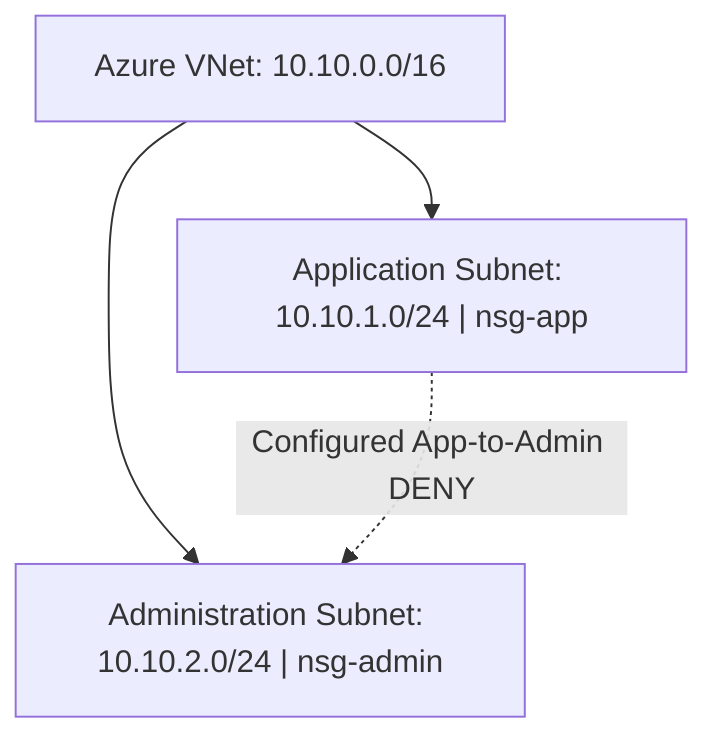

# Azure Enterprise Network Segmentation

## Project Overview

This hands-on Azure networking project demonstrates how Virtual Networks, subnets, and Network Security Groups (NSGs) can be used to restrict unnecessary communication between application and administrative infrastructure.

The project simulates a real-world enterprise security scenario involving network segmentation, access controls, troubleshooting, and automated configuration validation.

**Project Status:** Azure network infrastructure deployed. Configuration validated using Azure CLI and a Bash validation script (8/8 checks passed). Live traffic testing has not been performed.

## Business Problem

Enterprise environments frequently contain application servers and administrative systems that require different levels of access.

If unnecessary network communication is permitted, a compromised application server could potentially provide an attacker with additional paths into administrative infrastructure.

**Objective:** Configure network restrictions designed to prevent application-subnet systems from initiating connections to the administration subnet.

## Technologies Used

- Microsoft Azure
- Azure Virtual Networks
- Azure Subnets
- Azure Network Security Groups
- Azure CLI
- Azure Cloud Shell (Bash)
- Bash scripting
- Git and GitHub

## Architecture



**Azure Region:** Central US (`centralus`)

**Resource Group:** `rg-enterprise-network-lab`

**Virtual Network:** `vnet-enterprise-lab`

**Address Space:** `10.10.0.0/16`

| Subnet | Address Range | Associated NSG |
|---|---|---|
| Application | 10.10.1.0/24 | nsg-app |
| Administration | 10.10.2.0/24 | nsg-admin |

Both subnets are located within the same Azure Virtual Network.

Subnet separation alone does not enforce network isolation. NSG rules provide the configured traffic restrictions.

## Security Implementation

### Application Subnet

| Setting | Value |
|---|---|
| NSG | nsg-app |
| Rule | Deny-App-to-Admin |
| Direction | Outbound |
| Priority | 100 |
| Source | 10.10.1.0/24 |
| Destination | 10.10.2.0/24 |
| Protocol / Ports | Any |
| Action | Deny |

### Administration Subnet

| Setting | Value |
|---|---|
| NSG | nsg-admin |
| Rule | Deny-App-Inbound |
| Direction | Inbound |
| Priority | 100 |
| Source | 10.10.1.0/24 |
| Destination | 10.10.2.0/24 |
| Protocol / Ports | Any |
| Action | Deny |

The rules provide complementary controls intended to restrict application-initiated access to administrative infrastructure.

They do not represent a complete production network security policy.

## Repository Structure

```text
azure-enterprise-network-segmentation/
├── README.md
├── scripts/
│   ├── deploy.sh
│   ├── validate.sh
│   └── teardown.sh
└── screenshots/
    └── README.md
```

- `deploy.sh` defines the infrastructure deployment steps.
- `validate.sh` checks deployed Azure configuration.
- `teardown.sh` provides controlled resource group cleanup.
- `screenshots/` contains evidence captured during implementation and validation.

All three Bash automation scripts have been committed to the repository.

## How to Run

### Prerequisites

- An Azure subscription with sufficient permissions
- Azure CLI
- Bash
- Git for local repository cloning

### 1. Clone the repository

```bash
git clone https://github.com/mustaafawaalee/azure-enterprise-network-segmentation.git
cd azure-enterprise-network-segmentation
```

### 2. Verify Azure authentication

In Azure Cloud Shell, authentication is generally available automatically.

For a local Azure CLI installation:

```bash
az login
```

Verify the selected Azure subscription:

```bash
az account show --query "{Name:name,IsDefault:isDefault}" -o table
```

### 3. Deploy the lab

```bash
bash scripts/deploy.sh
```

This script is designed to create:

- One Azure resource group
- One virtual network
- Two subnets
- Two Network Security Groups
- Two custom deny rules
- Both subnet-to-NSG associations

**Status:** Deployment script committed but not yet tested end-to-end.

The script is intended for a clean environment and refuses to overwrite an existing lab resource group.

Review outbound-access settings and potential resource costs before testing deployment.

### 4. Validate the infrastructure

```bash
bash scripts/validate.sh
```

The validation script checks:

- Application NSG direction
- Application NSG action
- Application NSG priority
- Administration NSG direction
- Administration NSG action
- Administration NSG priority
- Application subnet NSG association
- Administration subnet NSG association

**Observed result: 8/8 configuration checks passed.**

The validation script was successfully executed against the deployed Azure lab.

### 5. Clean up resources

After saving project evidence and reviewing the resource group contents:

```bash
bash scripts/teardown.sh
```

The teardown script requests confirmation before deleting the dedicated lab resource group.

**Status:** Teardown script committed. Execution has not been verified.

Deleting the resource group permanently removes the Azure resources contained within it.

## Troubleshooting Experience

### Problem

During implementation, the administration NSG rule was initially configured with the incorrect direction.

The intended inbound deny rule had been configured as an outbound rule.

### Investigation

I used Azure CLI to inspect the rule configuration.

The command output revealed:

- Rule: Deny-App-Inbound
- Actual direction: Outbound
- Expected direction: Inbound

### Resolution

I corrected the rule to use the intended inbound direction.

### Verification

I used Azure CLI to confirm:

- Direction: Inbound
- Access: Deny
- Priority: 100

This experience demonstrated why cloud security configurations should be verified after deployment rather than assumed to be correct.

## Automated Configuration Validation

I created and executed a Bash validation script that checks the NSG rules and subnet associations against the expected configuration.

### Actual Validation Results

| Validation Check | Result |
|---|---|
| nsg-app direction | PASS |
| nsg-app access | PASS |
| nsg-app priority | PASS |
| nsg-admin direction | PASS |
| nsg-admin access | PASS |
| nsg-admin priority | PASS |
| snet-app NSG association | PASS |
| snet-admin NSG association | PASS |

**Final result: 8/8 PASS**

These results demonstrate that the checked Azure configuration properties matched the expected values.

They do not establish that actual network packets were blocked.

### Validation Evidence

The Bash validation script was executed against the deployed Azure infrastructure.

All eight automated configuration checks passed.

Supporting evidence is available in the repository's [validation screenshots](screenshots/).

The screenshots document the observed Azure configuration and automated verification output.

**Validation limitation:** These checks confirm Azure resource configuration only. Live network connectivity testing has not been performed.

## Design Decisions

### Why two deny rules instead of one?

### Why doesn't the App-to-Admin deny break Admin-to-App SSH?

### What default rule does priority 100 override?

## Live Traffic Test Plan

**Status:** Not performed.

| Test | Predicted | Actual | Rule That Matched |
|---|---|---|---|
| App→Admin TCP 22 | | | |
| Admin→App TCP 22 | | | |
| App→Admin with admin inbound rule removed | | | |
| App→Admin with app outbound rule removed | | | |

The table will be completed only after suitable connectivity tests have been performed.

## What I Would Do Differently in an Enterprise Environment

### 1. Implement Least-Privilege Network Access

I would define approved traffic flows and implement explicit allow rules for necessary connections, combined with appropriate deny-all restrictions.

This would provide stronger network segmentation than relying only on two targeted deny rules.

### 2. Implement Infrastructure as Code

I would use Terraform or Bicep to deploy infrastructure consistently through version-controlled definitions.

I would also implement automated configuration checks and code review to identify incorrect NSG properties before production deployment.

### 3. Implement Monitoring and Operational Controls

I would evaluate network diagnostics, security monitoring, alerting, Azure Policy, and documented change management.

Production architecture would also account for operational requirements, availability, and service costs.

## Lessons Learned

This project strengthened my understanding of:

- Azure virtual networking
- Subnet address planning
- Network Security Group associations
- NSG rule direction and priority
- Azure CLI troubleshooting
- Bash scripting
- Automated infrastructure configuration validation
- GitHub technical documentation

The most important lesson was that creating infrastructure is only part of the engineering process.

Configurations must be validated, troubleshooting must be documented, and automation should be designed to produce repeatable results.

## Next Improvements

- Test deployment automation in a clean environment.
- Complete the Design Decisions section.
- Conduct live network connectivity testing.
- Expand validation to include additional network security properties.
- Verify teardown automation and resource cleanup.
- Document actual costs if applicable.

## Project Context

This project is an independently built Azure educational lab based on a realistic enterprise networking scenario.

It does not represent a production deployment or work completed for an employer.
